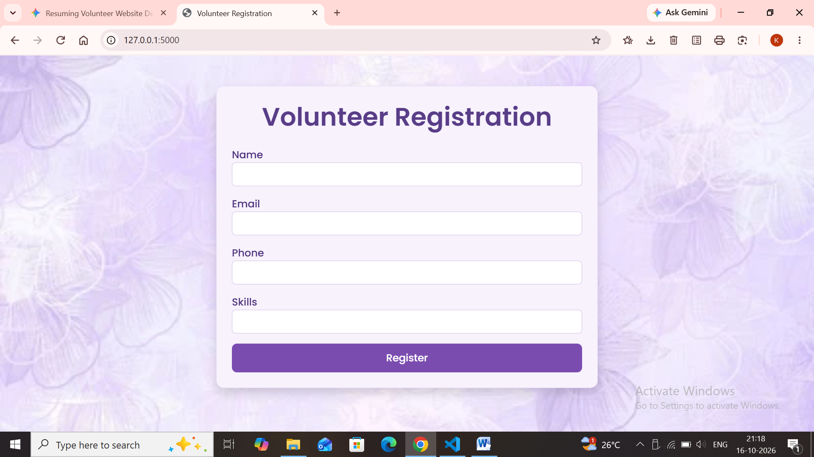
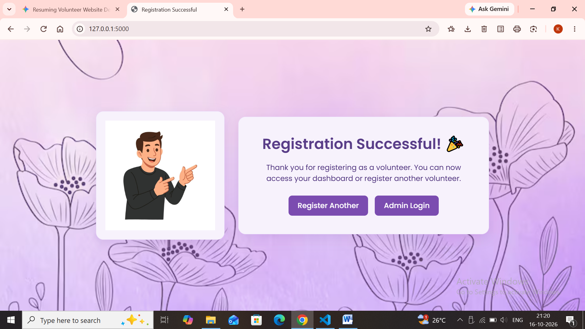
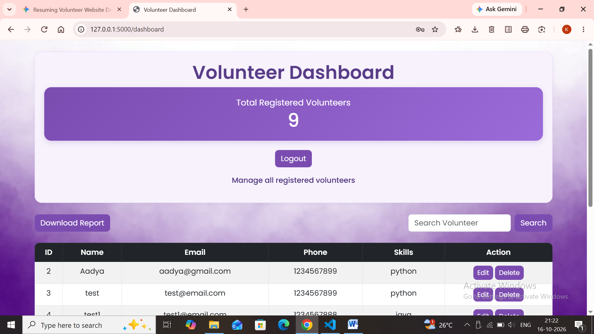

# 🌸 Volunteer Registration System

A modern, secure, and fully-featured **Volunteer Registration System** built with **Python (Flask)**, **SQLite**, **HTML/CSS**, and **Bootstrap 5**. Designed with a  cohesive **attractive pastel theme**, custom fonts, and custom success layouts.

---

## 🌟 Key Features

- **Volunteer Registration Portal:** A clean, responsive registration form allowing users to submit their personal details and skills with instant validation.
- **Interactive Success Page:** Features a custom animated greeting layout featuring a pointing character directing users toward action buttons ("Register Another" / "Admin Login").
- **Secure Admin Authentication:** Admins log in securely using password hashing (`werkzeug.security`) protecting all sensitive routes via session management.
- **Admin Dashboard:** 
  - Real-time live count of total registered volunteers.
  - Search functionality to instantly find volunteers by name.
  - Full CRUD Operations: View, Edit, and Delete volunteer records.
- **Report Generation:** One-click CSV export of all registered volunteer data directly from the dashboard.
- **Lavender Aesthetic:** Custom pastel vector background artwork, soft light purple container cards (`#f7f2fc`), and rich purple buttons (`#7b4cb0`).

---

## 🛠️ Tech Stack

- **Backend:** Python, Flask, SQLite
- **Frontend:** HTML5, CSS3, Bootstrap 5, Google Fonts (Poppins)
- **Security:** Werkzeug Security (Password Hashing), Flask Sessions

---

## 📸 Project Screenshots

<table>
  <tr>
    <td align="center" width="25%">
      <b>Registration Page</b><br><br>
      <br>
      <sub>User sign-up portal</sub>
    </td>
    <td align="center" width="25%">
      <b>Registration Successful</b><br><br>
      <br>
      <sub>Success confirmation screen</sub>
    </td>
    <td align="center" width="25%">
      <b>Dashboard</b><br><br>
      <br>
      <sub>Volunteer management & stats</sub>
    </td>
  </tr>
</table>


---

## 🚀 Getting Started & Installation

1. **Clone the repository:**
   ```bash
   git clone [https://github.com/your-username/volunteer-registration-system.git](https://github.com/your-username/volunteer-registration-system.git)
   cd volunteer-registration-system

2. **Install dependencies:**
```bash
Bash
pip install flask werkzeug
```
3. **Run the application:**
```bash
Bash

python app.py
```
4. **Access in your browser:**
```bash
User Portal: http://127.0.0.1:5000/

Admin Login: http://127.0.0.1:5000/login (Default credentials: username admin, password admin123)
```